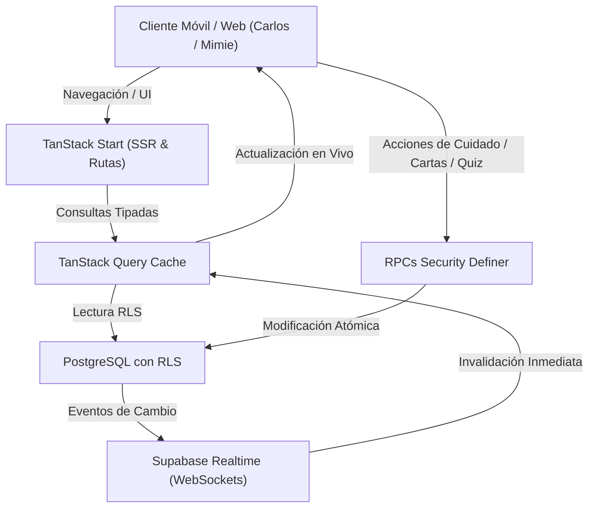

# Arquitectura del Sistema: Un lugar para nosotros dos

Este documento detalla la arquitectura técnica, los principios de diseño y los componentes clave de la aplicación privada para **Carlos & Mimie**.

---

## 1. Visión General y Principios de Diseño

1. **Intimidad y Privacidad Absoluta**:
   - Espacio restringido a exactamente dos miembros (`private_spaces` de 2 usuarios).
   - Políticas de seguridad a nivel de fila (Row Level Security - RLS) en todas las tablas de PostgreSQL.
   - Acceso con tokens JWT emitidos por Supabase Auth.
   - Las cartas confidenciales y las respuestas de "¿Cuánto nos conocemos?" permanecen selladas y cifradas en base de datos hasta que se cumplan las condiciones de revelación simultánea o fechas programadas.

2. **Aromas Visuales e Identidad Estética**:
   - **Paleta Central**: Crema cálido (`#F7F0E6`), rosa lirio (`#E8B9C4`), tonos suaves y serenos adaptados a móviles (PWA).
   - **Aislamiento Temático**:
     - *Estética de L (Death Note)*: Exclusiva de cartas confidenciales y expedientes de deducción (`.l-dossier-card`, sellos de cera, revelación de expedientes).
     - *Estética de Levi Ackerman (Attack on Titan)*: Exclusiva de la sección de regalos de honor (`/regalos`), caja negra de obsidiana, broche plateado y pañuelo inmaculado.

3. **Economía y Cuidado Unificado**:
   - Una sola moneda común ganada jugando y cuidando juntos a Appa y al Lirio.
   - Cero microtransacciones reales; el progreso se basa en el amor y la constancia compartida.

---

## 2. Pila Tecnológica (Tech Stack)

| Capa | Tecnología | Propósito |
| :--- | :--- | :--- |
| **Framework Web** | TanStack Start (Nitro SSR) | Renderizado en servidor, enrutamiento basado en archivos con tipado estricto. |
| **Librería UI** | React 19 + TypeScript | Renderizado reactivo, concurrencia y seguridad de tipos de extremo a extremo. |
| **Estilos** | Tailwind CSS v4 + Radix UI | Componentes accesibles, diálogos, variables de color oklab y animaciones CSS fluidas. |
| **Gestión de Estado** | TanStack Query v5 | Caché de servidor, revalidación automática e invalidación reactiva. |
| **Backend & DB** | Supabase (PostgreSQL 15+) | Autenticación, base de datos relacional, Storage y Realtime WebSockets. |
| **Migraciones** | Drizzle Kit + SQL | 25 migraciones versionadas y reproducibles (`drizzle/migrations/`). |
| **Testing** | Vitest | Pruebas unitarias para cálculo de estados, versículos, economía y lógica de pareja. |

---

## 3. Diagrama de Flujo de Datos

---

## 4. Estructura de Enrutamiento

- `/`: Portada romántica, contador de amor, versículo determinista NTV del día, estado rápido de Appa y el Lirio.
- `/_authenticated/mensajes`: Banco de mensajes diarios, cartas con sello confidencial L y buzón.
- `/_authenticated/regalos`: Salón de obsequios con estética distinguida de Levi Ackerman.
- `/_authenticated/appa`: Hogar interactivo 2.5D de Appa (habitaciones, caminata fluida, post-its, minijuegos y tienda).
- `/_authenticated/lirio`: Cultivo interactivo del lirio rosa (sustrato, drenaje, luz, abono, señales de estrés).
- `/_authenticated/quiz`: "¿Cuánto nos conocemos?", preguntas secretas y revelación simultánea.
- `/_authenticated/espiritual`: Devocionales, peticiones de oración compartidas y versículos bíblicos NTV categorizados.
- `/_authenticated/espacio`: Gestión de membresía, perfil de pareja y generación segura de códigos de invitación.
- `/_authenticated/album`: Recuerdos fotográficos con fecha y dedicatoria.
- `/_authenticated/diario`: Diarios íntimos (compartidos y privados).
